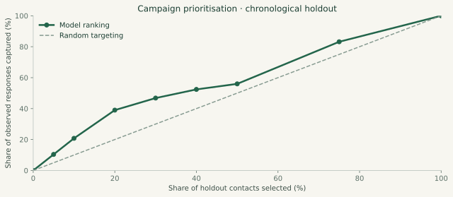

# Campaign ranking under a changing response rate

**Question.** Can a model prioritize contacts under a fixed call budget without using information from a completed call?

## Design

Use UCI's full `bank-additional-full.csv` (41,188 date-ordered records). Split rows 60%/20%/20% into training (24,712), validation (8,238), and holdout (8,238). Exact timestamps and customer IDs are unavailable, so the split approximates chronology and cannot prove customer independence.

Inputs are campaign scheduling/context, previous campaign history, and economic indicators. Completed-call duration and final campaign contact count are excluded. Age, marital status, job, education, and credit/loan variables are also omitted. This does not guarantee fairness or remove all proxy relationships.

The `pdays=999` sentinel becomes a separate prior-contact flag plus zero elapsed days. Categorical encoding and numeric scaling are fitted within each pipeline. Compare logistic regression and 7-/15-leaf histogram gradient boosting on validation average precision; select the 15-leaf model and refit on the first 80% of data.

## Results

At a **20% contact budget**, the ranking selects 1,648 contacts and contains 991 observed positive responses:

| Measure | Holdout result |
| --- | ---: |
| Precision at 20% | 60.13% |
| Response capture at 20% | 39.02% |
| Lift over random selection | 1.95× |
| Average precision | 0.473 |
| ROC AUC | 0.631 |
| Brier score | 0.253 |

The response rate changes from 4.81% in training to 11.07% in validation and 30.83% in the holdout. Predicted probabilities substantially underestimate observed frequencies. Brier score only modestly improves on the 0.273 constant baseline derived from the first 80% of rows.

## Interpretation

There is a useful ranking signal, but probability calibration is weak. The 1.95× figure is **retrospective ranking lift**, not causal uplift or incremental conversion. No campaign revenue or production impact is claimed. Tied scores use original row order; the budget is a fraction of the entire held-out batch, not a deployed score threshold.

Before operational use, validate exact decision-time inputs and economic release dates, obtain customer identifiers, evaluate a threshold chosen on earlier data, monitor drift, and recalibrate on recent observations. A randomized experiment would be needed to attribute response changes to targeting.

## Reproduce and audit

Run `python run.py campaign`. Inspect [source](../../src/campaign.py), [metrics and budget table](metrics.json), [saved scores](holdout_predictions.csv), and [SQL deciles](../../sql/campaign_deciles.sql). The tests independently recompute contact counts, response capture, lift, and Brier score.

Data: Moro, S., Rita, P., & Cortez, P. (2014), *Bank Marketing*, UCI. [DOI](https://doi.org/10.24432/C5K306), CC BY 4.0. [Source attribution](../../DATA_SOURCES.md).

