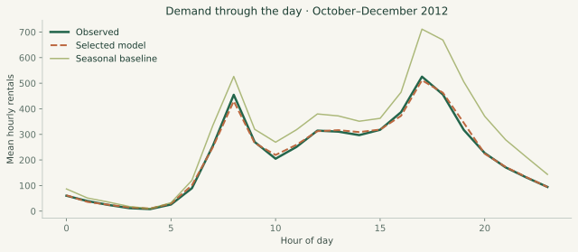

# Estimating hourly bike demand

**Question.** Can a weather-aware model estimate hourly rentals more accurately than a recent weekday/hour average?

## Design

The UCI Bike Sharing hourly file contains 17,379 observations from 2011–2012. Records are sorted by date and hour. Training ends on June 30, 2012 (13,003 rows); July–September provides validation (2,208); October–December is the final holdout (2,168). After choosing hyperparameters on validation MAE, the selected model is refit on all pre-October data.

The baseline averages demand by weekday and hour across the last 90 calendar days of training. Ridge regression and histogram gradient boosting with 15, 31, or 63 leaves are compared. The 63-leaf booster wins on validation MAE. The raw record index and both target components, `casual` and `registered`, are excluded. Weather is observed, not forecast: this is conditional demand estimation, not a validated day-ahead forecasting system.

## Results

| Holdout measure | Selected model | Seasonal baseline |
| --- | ---: | ---: |
| MAE | 42.26 | 89.90 |
| RMSE | 67.36 | 143.83 |
| R² | 0.888 | 0.491 |

Relative MAE reduction is **53.0%**. A paired bootstrap over calendar days (2,000 resamples, seed 42) gives a 95% resampling interval of 47.9%–57.5%. This respects dependence among hours within a day, but not between days; it does not include model-selection or training uncertainty.

The model's monthly MAE is 40.11 in October, 40.58 in November, and 45.93 in December. The baseline error grows to 123.87 in December, so the headline improvement depends partly on the seasonal transition. The average daily profile shows that the model follows commute peaks, but averaging hides day-specific errors.

## Limits and next experiment

This is one historical city and one final test period. Missing hours remain missing, not zero. Actual weather would not be fully available for advance planning. The result is not evidence of reduced fleet cost or fewer shortages.

A deployment-oriented follow-up should use archived weather forecasts, rolling-origin splits, station-level availability, and week-ago/month-aware baselines. Costs of over- and under-supply should be specified before selecting a decision rule.

## Reproduce and audit

Run `python run.py demand`. See [source](../../src/demand.py), [metrics](metrics.json), [holdout predictions](holdout_predictions.csv), and [SQL cross-check](../../sql/demand_by_month.sql). The test suite recomputes headline MAE from saved predictions.

Data: Fanaee-T, H. (2013), *Bike Sharing*, UCI. [DOI](https://doi.org/10.24432/C5W894), CC BY 4.0. This independent study sorts and models the original data. [Source attribution](../../DATA_SOURCES.md).

