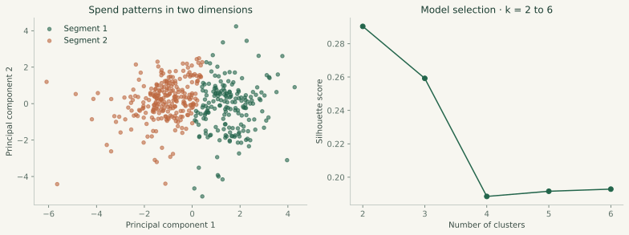

# Customer spending patterns and their stability

**Question.** Do broad customer spending groups survive changes to the sample and removal of its largest spenders?

## Design

Use six annual spending variables for 440 UCI Wholesale customers. Exclude channel and region from fitting. Apply `log1p`, standardize, and fit k-means with 30 initializations and seed 42. Compare k = 2 through 6 by silhouette score. Two clusters score highest (0.290), versus 0.259 for three clusters.

For 100 bootstrap samples, refit both preprocessing and clustering, then predict assignments for the original customer set. Adjusted Rand index (ARI) compares partitions while ignoring arbitrary label names. A separate sensitivity fit removes the highest 1% of customers by total spending.

## Results

| Measure | Result |
| --- | ---: |
| Selected clusters | 2 |
| Cluster sizes | 188 / 252 |
| Silhouette | 0.290 |
| Median bootstrap ARI | 0.937 |
| Central 95% bootstrap ARI range | 0.675–1.000 |
| ARI after top-1% spend removal | 0.973 |

The 188-customer group is grocery-led, with higher median grocery, milk, and detergents/paper spending. The 252-customer group has higher median fresh and frozen spending. Names describe relative spending profiles, not validated commercial personas.

For a post-fit comparison, retail customers account for 71.3% of the grocery-led group and 3.2% of the other group. Channel was not used as a clustering input. A two-component PCA chart explains 71.3% of transformed-feature variance; clustering itself uses all six features.

## Interpretation

Assignments are fairly stable, but the modest silhouette indicates overlap. Resampling stability is not out-of-sample predictive accuracy. All cluster selection and descriptive evaluation use the same exploratory sample; the bootstrap range is a stability summary, not a confidence interval on business impact.

The dataset lacks repeat transactions, future outcomes, and margin information. It cannot establish churn risk, lifetime value, or causal response to offers. Monetary units are unspecified, so values are not labeled as dollars.

A next study should assess a later cohort, compare mixture-based alternatives, and test an operational use such as assortment planning with a predeclared outcome measure.

## Reproduce and audit

Run `python run.py segments`. See [source](../../src/segments.py), [complete metrics](metrics.json), [assigned customer records](customer_segments.csv), and [SQL channel summary](../../sql/segment_channel_mix.sql). The tests reconcile profile medians and group sizes with saved records.

Data: Cardoso, M. (2013), *Wholesale customers*, UCI. [DOI](https://doi.org/10.24432/C5030X), CC BY 4.0. [Source attribution](../../DATA_SOURCES.md).
